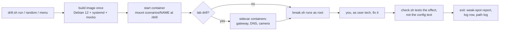

# linux-drills

Hands-on Linux break-fix practice: each drill boots a real systemd container that is actually broken, you fix it
from a shell, and `check` proves the fix worked.

> **Status: work in progress.** I use it for my own practice and still add and change scenarios.

## Why I built it

Real troubleshooting is done live, on a box you've never seen, with someone waiting. Quizzes and flashcards
don't train that. So I built a lab that breaks real Linux boxes in realistic ways and makes you fix them with your
hands, on a clock, then proves the fix. I use it to keep my troubleshooting sharp, with a coach that makes me
verify the fix myself (curl the page, ping the camera, read `systemctl status`) before I run `check`. A real
server has no `check` command, so the habit that matters is proving it on your own.

The scenarios are set on a fictional camera/NVR edge box that runs video analytics on a GPU, because that kind of
box mixes systemd, networking, Docker and GPU problems in one place.

## What you get

- **41 scenarios** across systemd, disk, CPU/memory, logs, networking (IP, routes, DNS, DHCP, VLANs, firewall,
  SSH), Docker, and a mocked NVIDIA GPU. 6 of them are multi-step **chain** drills.
- **211 wrong-fix traps** (`scenarios/*/traps/*.sh`): `chmod 777`, `rm` on a log a daemon still holds open,
  restart-and-hope, edit-but-never-reload, and so on. The selftest proves `check` still fails after each one.
- **In the box:** `ticket`, `hint` (3 per drill, each more specific), `check`, `playbook` (a first-60-seconds
  sweep), `solution` (Observe / Narrow / Act / Verify, with the sentence to say out loud at each step), `timer`,
  `answer "..."` for diagnose-and-escalate tickets, and `next`.
- **A weak-spot report** at the end of each drill, built from your shell history: `fdisk` for a full disk,
  `kill -9` before a plain `kill`, `chmod 777`, network tools before local checks, typos like `ldisk`.
- **A path log** of every drill (`./drill.sh review`): each command with its time and exit status.
- **A one-page printable cheat sheet** (`print/cheatsheet.html`, plus `CHEATSHEET.md`) grouped by job: which disk
  is full, what owns this port, is the GPU alive.

## How it works



- `drill.sh` is the host-side launcher. It builds one shared image (`image/`), starts a container per drill,
  runs the scenario's `break.sh`, and drops you in as `tech` with sudo.
- Each `scenarios/<name>/` holds `ticket.txt`, `hints.txt`, `break.sh`, `check.sh`, `solution.sh`,
  `solution.md`, `traps/*.sh` and `meta.env`. `scenarios/SPEC.md` is the contract for writing one.
- Network drills put the far end (gateway, DNS, cameras, a NOC host) in sidecar containers on throwaway Docker
  networks, so none of it shows up in `ps`, `ss` or `/etc` on the box you are fixing.
- `nvidia-smi`, `lspci`, `adb`, `docker` and a few agents inside the box are small Python/shell mocks that
  print realistic output for the commands the drills use. There is no real GPU, phone or Docker engine inside.

### How it stays honest

`./drill.sh selftest` runs every scenario through three gates in fresh containers:

1. **broken:** `check` must fail on the untouched box;
2. **wrong fixes:** each trap is applied and `check` must still fail;
3. **fixed:** `solution.sh`, run as `tech` with sudo, must make `check` pass.

Last full run (2026-10-05, about 19 minutes on a desktop including the first image build): all 41 scenarios
passed all three gates.

## Install

You need a Linux machine (or a Linux VM) with Docker. Any recent distro with cgroup v2 works (Debian 12+,
Ubuntu 22.04+, Fedora). About 1 GB of disk. No internet is needed after the image is built.

1. Install Docker and git. On Debian or Ubuntu:
   ```bash
   sudo apt update
   sudo apt install docker.io git
   ```
2. Let your user run Docker, then log out and back in so it takes effect:
   ```bash
   sudo usermod -aG docker $USER
   ```
   Check it: `docker ps` should print an empty table, not "permission denied".
3. Get the code:
   ```bash
   git clone https://github.com/JPInert/linux-drills.git
   cd linux-drills
   ```
4. See the list. The first drill builds the image (about a minute):
   ```bash
   ./drill.sh list
   ```

On an older cgroup-v1 host, prefix commands with `DRILL_PRIVILEGED=1`.

## Running it

```bash
./drill.sh random               # least-recently-done drill, name hidden until you finish
./drill.sh random --level 1     # easy ones (also --area network|gpu|docker|systemd|disk|cpu-mem|logs|chain, --no-lab)
./drill.sh menu                 # pick an area and a level from a menu
./drill.sh run disk-full        # a specific drill
./drill.sh run port-conflict --ssh   # enter over real ssh on 127.0.0.1:2222, like a remote session
./drill.sh session 5            # five random drills back to back
./drill.sh log                  # your history: best times, hints used
./drill.sh review               # every command you typed in the last drill, with times
./drill.sh selftest             # prove every scenario breaks and fixes (takes a few minutes)
./drill.sh clean                # remove every drill container and the lab networks
```

Optional shortcuts for `~/.bashrc` (assuming `drill.sh` is on your PATH):

```bash
alias drillnow='drill.sh random --ssh'
alias drillmenu='drill.sh menu --ssh'
```

Inside a drill you land as `tech` on a box called `edge-nvr-03`. Read the ticket, look before you touch, fix it,
prove it yourself, then run `check`. `exit` ends the drill and removes the container. Your log lives in
`~/.local/share/linux-drills/` (change it with `DRILL_HOME`).

To rebuild the cheat sheet PDF: `cd print && node render.mjs` (needs Node 22+ and a headless Chrome; set
`CHROME=/path/to/chrome`).

## Safety

- Containers are not `--privileged`. Each box gets `NET_ADMIN` and `SYS_PTRACE`, 1 CPU, 512 MB and 1024 pids.
- systemd needs a writable cgroup, so the box mounts the host cgroup tree read-write with `--cgroupns=host`
  (the usual recipe for systemd in Docker). That is real trust: run it on your own machine or a VM, not a
  shared server.
- Lab networks are plain bridges with NAT off. Nothing is published to the host except `127.0.0.1:2222` with
  `--ssh`.

## Container quirks

- `free`, `uptime`, `nproc` and `df /` show the host. No drill depends on them.
- `/etc/resolv.conf` is a Docker bind mount: `sed -i` on it fails, use `sudo nano` or `sudo tee`.
- No reboots, no `dmesg`.
- Only one `[lab]` drill can run at a time: the lab containers and networks have fixed names.
- The 3 `adb` drills are off by default (`random` skips them); run them by name or with `--tag adb`.

## What is not included

- No real NVIDIA driver, CUDA, Android `adb`, AWS SSM agent or Docker engine inside the box. All of those are
  hand-written mocks in `image/rootfs/` that cover only what the drills need.
- No prebuilt cheat sheet PDF. Build it with `print/render.mjs`.
- The live coach I used while drilling (a separate terminal helper) is not part of this repo. The in-box
  `playbook`, `solution` and weak-spot report are.

## Adding a scenario

Read `scenarios/SPEC.md`, copy `scenarios/port-conflict`, then run `./drill.sh selftest <name>`.
`CLAUDE.md` has the contributor rules.

## Built with Claude Code

I designed the lab, the failure modes and what each drill teaches, and built it with Claude Code as my pair.
The selftest breaks and fixes all 41 scenarios automatically, so nothing ships that I haven't proven solvable.

## License

MIT. See `LICENSE`.
